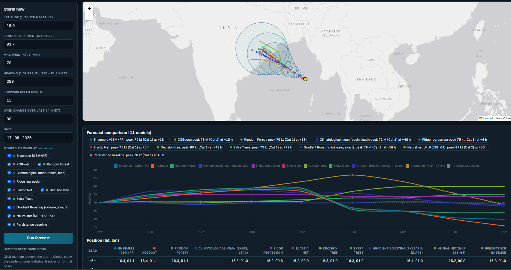
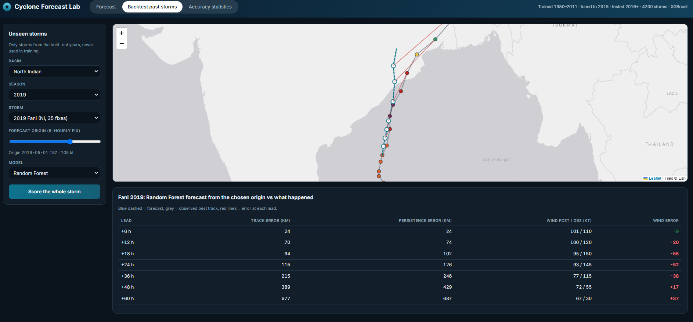
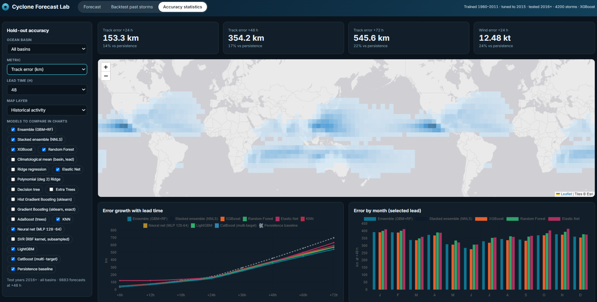

# Cyclone Forecast Lab

**Machine-learning forecasts of tropical-cyclone track and intensity (6-72 h) for every ocean basin, with 15+ models benchmarked head-to-head and an interactive browser app.**

  

> **About this project:** a personal side project, built with heavy AI assistance ("vibe-coded" with Claude).
> The problem framing, the choice of data, features and models, and the direction of each iteration are mine, starting from my
> original Atlantic-only notebooks in [`legacy/`](legacy/). AI generated much of the implementation, which I ran, tested and iterated on.
> **Not an operational forecast.** For real decisions use official agencies (NHC, JTWC, JMA, IMD, BoM, Meteo-France).





## Highlights
- **Global:** North Atlantic, East/Central Pacific, Western Pacific, North Indian, South Indian, South Pacific and South Atlantic (NOAA IBTrACS v04r01, 1980-present).
- **Direct multi-horizon forecasts** (6, 12, 18, 24, 36, 48, 60, 72 h) rather than recursive roll-outs, which compound error.
- **Model comparison:** 15+ models on identical unseen storms, scored against a persistence baseline, with a leaderboard by basin, month and lead time.
- **Leakage-safe evaluation:** chronological, storm-wise split (train <= 2011, tune 2012-2015, test >= 2016).
- **Serverless app:** trained models are exported to JSON and evaluated in JavaScript, so one HTML file does everything. A built-in self-test checks JavaScript against Python predictions for every exported model.

## Quick start
```bash
git clone https://github.com/<your-username>/cyclone-forecast-lab.git
cd cyclone-forecast-lab
python -m venv .venv
source .venv/bin/activate            # Windows: .venv\Scripts\activate
pip install -r requirements.txt
python run_pipeline.py --download    # download IBTrACS (~100 MB), train, evaluate, build the app
```
Then open `outputs/hurricane_app.html` in a browser (it needs internet for map tiles, fonts and the Leaflet/Chart.js CDNs).

| Command | What it does |
|---|---|
| `python run_pipeline.py --download` | Full run on real data |
| `python run_pipeline.py --data path/to/ibtracs.since1980.list.v04r01.csv` | Use a file you already downloaded |
| `python run_pipeline.py --models fast` | Skip the slow models (SVR, AdaBoost, exact GBM, polynomial ridge) |
| `python run_pipeline.py --models ridge,extra,mlp,lgbm` | Choose your own benchmark set |
| `python run_pipeline.py --list-models` | List available models |
| `python run_pipeline.py --synthetic 500 --fast` | Offline smoke test on fake data (numbers are meaningless) |

A full run on real data takes roughly 30-90 minutes. `docs/demo_synthetic.html` is a prebuilt app on fake data so you can try the interface immediately.

## The app
| Tab | What you can do |
|---|---|
| **Forecast** | Enter a storm's position, wind, heading, speed and date (or click the map), tick any number of models, and compare their tracks and intensity side by side: map overlay, intensity chart, and lead-time tables. Circles show the ensemble's mean historical track error in that basin. |
| **Backtest past storms** | Pick any storm from the unseen test years, drag the forecast origin along its life, and compare forecast to observation. "Score the whole storm" averages every origin against persistence. |
| **Accuracy statistics** | Choose a basin, metric and lead time: KPI cards, an error map by 5-degree cell or historical activity, error growth by lead, error by month, a month x basin heat table, and a **model leaderboard**. |

## Models compared
Every model predicts the same three targets (east km, north km, wind change in kt) from the same 28 features.

| Key | Model | Runs in app |
|---|---|:-:|
| `gbm` | XGBoost (scikit-learn GBM if XGBoost is missing) | yes |
| `rf` | Random Forest | yes |
| `ens` | Inverse-MSE blend of `gbm` + `rf` | yes |
| `stack` | Non-negative least-squares blend of all models (weights from validation years only) | if all parts export |
| `hgb` | Hist Gradient Boosting (scikit-learn) | yes |
| `gbr` | Gradient Boosting, exact (scikit-learn) | yes |
| `extra`, `tree` | Extra Trees, Decision Tree | yes |
| `ridge`, `elasticnet` | Linear baselines | yes |
| `mlp` | Neural net (128-64) | yes |
| `climmean` | Mean residual per basin and lead | yes |
| `base` | Persistence (constant velocity and intensity) | yes |
| `poly_ridge`, `ada`, `knn`, `svr` | Polynomial ridge, AdaBoost, KNN, RBF SVR | Python only |
| `lgbm`, `catboost` | LightGBM, CatBoost (optional installs) | Python only |

Add your own: write one function with the `@zoo("key", "Label")` decorator in `models.py` that returns an object with `.predict(X)`.

## Results
Fill in from your own run (`outputs/model_comparison.csv` has everything).

| Model | Track error +24 h (km) | Track error +48 h (km) | Wind MAE +24 h (kt) | Skill vs persistence (48 h track) |
|---|---|---|---|---|
| Persistence baseline | | | | 0% |
| Ridge regression | | | | |
| Random Forest | | | | |
| XGBoost | | | | |
| Stacked ensemble | | | | |

## How it works
```
IBTrACS CSV -> data.py -> features.py -> models.py -> evaluate.py -> stats.json, model_comparison.csv
 (global)      QC, 6-h     one shared     core + zoo    hold-out         |
               segments,   feature fn     + stacking    scoring          v
               basins                          |                  export_app.py -> hurricane_app.html
                                               +-- trees / weights -> JSON ---------^  (JS runs the same models)
```
**Method**
- **Data hygiene:** only 00/06/12/18Z fixes; any time gap starts a new segment so lags and leads never span irregular intervals; 1-minute winds (`USA_WIND`) in every basin for consistency.
- **Targets:** east/north displacement in km, modelled as a *residual from constant-velocity extrapolation*, and wind change in kt. Pressure is derived from wind by a per-basin fit (most non-Atlantic fixes lack it).
- **Features (28):** dateline-safe longitude, hemisphere, basin one-hots, season phase aligned between hemispheres, 6/12/24 h motion and intensity trends, lead time, and a basin x month x latitude 95th-percentile intensity table (fit on training years only) as a potential-intensity proxy.
- **Evaluation:** great-circle track error (km), wind MAE and bias (kt), share within 10 kt; every test origin is scored; skill is relative to persistence.

## Project structure
```
cyclone-forecast-lab/
├── run_pipeline.py        # entry point: data -> train -> evaluate -> maps -> app
├── config.py              # URLs, basins, leads, split years, hyper-parameters
├── data.py                # IBTrACS download/QC, basin assignment, wind->pressure fit
├── features.py            # compute_features() shared by training, evaluation and the app
├── models.py              # core models, model zoo, ensemble, stacking
├── evaluate.py            # hold-out scoring, leaderboard
├── export_app.py          # models -> JSON, storm library, HTML inlining
├── maps.py                # static maps and charts
├── synthetic.py           # fake data for offline smoke tests only
├── app/hurricane_app.html # app template
├── legacy/                # original Atlantic-only notebooks
├── docs/                  # screenshots, synthetic-data demo
└── outputs/               # generated (git-ignored except a few small result files)
```

## Limitations
- No environmental predictors (SST, shear, steering flow, land interaction), so it will not match numerical weather prediction or official forecasts.
- Basins are assigned from position; the Atlantic/East-Pacific boundary is a simple line across Central America.
- The Forecast tab approximates 6/12/24 h history from heading, speed and 24 h wind change; the Backtest tab uses real observed history.
- Rapid intensification is hard for statistical models and will be under-predicted.

## Roadmap
ERA5 SST/shear/steering features, quantile or ensemble models for proper uncertainty cones, rapid-intensification classification, landfall-distance features.

## License, data and citation
Code: [MIT](LICENSE). Data and third-party components: see [NOTICE.md](NOTICE.md). Please cite IBTrACS (Knapp et al., 2010) if you use results, and see [CITATION.cff](CITATION.cff) to cite this project.
